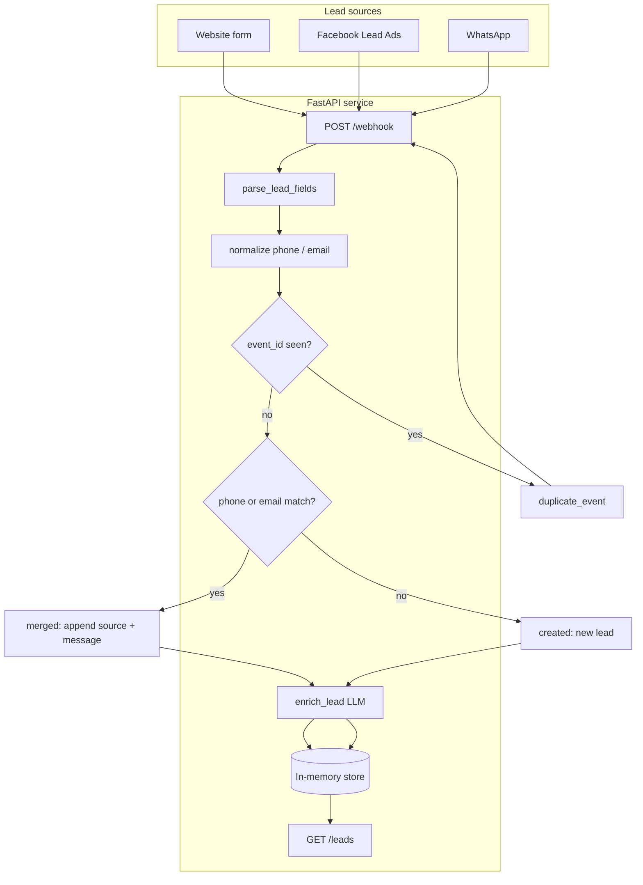
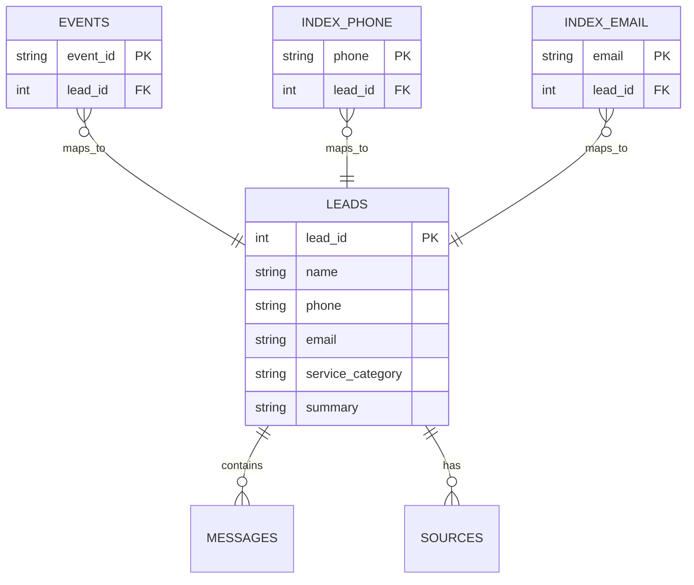
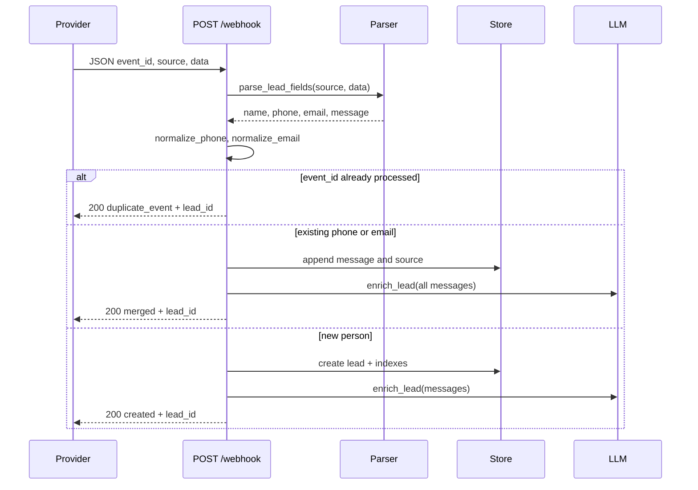
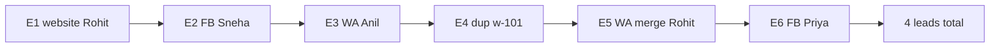
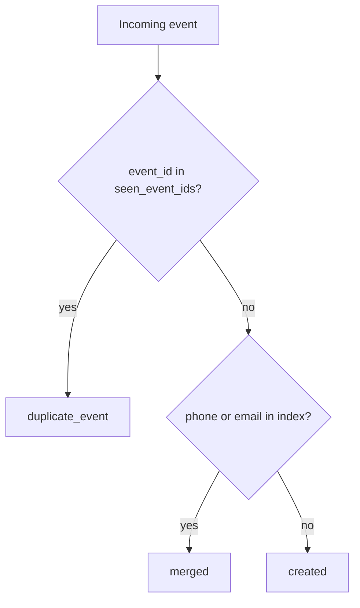

# Lead Tracker

**Multi-source lead webhook intake** for Parmarketing-style agency workflows. A single FastAPI service accepts leads from **website forms**, **Facebook Lead Ads**, and **WhatsApp**, normalizes contact data, deduplicates provider retries, merges the same person across channels, and enriches each lead with an LLM-assigned **service category** and **one-line summary**.

Built for reliability under interview time constraints: in-memory storage, synchronous enrichment (optional background in production), and a full **pytest** suite covering normalization, API contracts, and the official six-event fixture sequence.

---

## Table of contents

- [Features](#features)
- [Architecture](#architecture)
- [Request lifecycle](#request-lifecycle)
- [Data model](#data-model)
- [API reference](#api-reference)
- [Normalization rules](#normalization-rules)
- [Environment variables](#environment-variables)
- [Quick start](#quick-start)
- [Demo script](#demo-script)
- [Testing](#testing)
- [Project structure](#project-structure)
- [Production roadmap](#production-roadmap)

---

## Features

| Capability | Description |
|------------|-------------|
| **Multi-format ingestion** | One `POST /webhook` endpoint; payload shape depends on `source`. |
| **Field normalization** | Phone → 10 digits; email → lowercase; names/messages trimmed. |
| **Idempotent events** | Same `event_id` twice → `duplicate_event`, no data change. |
| **Person merge** | Match existing lead by normalized **phone** or **email** → append message & source. |
| **LLM enrichment** | `service_category` + English `summary` from all messages (OpenAI-compatible API). |
| **Fast responses** | Always HTTP **200** with `{ "status", "lead_id" }` on success paths. |

---

## Architecture

High-level components and data flow:



Storage indexes (in [`main.py`](main.py)):



---

## Request lifecycle

Sequence for a **new** event (not duplicate, not merge):



---

## Data model

Each lead returned by `GET /leads`:

```json
{
  "lead_id": 1,
  "name": "Rohit Sharma",
  "phone": "9876500011",
  "email": "rohit@greenleaf.in",
  "sources": ["website", "whatsapp"],
  "messages": [
    "Need Google Ads for our D2C brand, budget 1.5L/month",
    "Any update on my Google Ads query?"
  ],
  "service_category": "Performance Marketing",
  "summary": "D2C brand wants Google Ads at about 1.5 lakh per month and is following up."
}
```

**Service categories** (exactly one):

`SEO` · `Performance Marketing` · `Website` · `Social Media` · `AI Chatbot` · `Other`

---

## API reference

### `POST /webhook`

Ingest one lead event.

**Request body**

| Field | Type | Description |
|-------|------|-------------|
| `event_id` | string | Provider idempotency key (unique per logical event). |
| `source` | `"website"` \| `"facebook"` \| `"whatsapp"` | Determines how `data` is parsed. |
| `data` | object | Source-specific payload (see below). |

**Response** (always HTTP 200 on valid input)

| Field | Type | Description |
|-------|------|-------------|
| `status` | `"created"` \| `"merged"` \| `"duplicate_event"` | Processing outcome. |
| `lead_id` | integer | Target lead record. |

**`data` by source**

| Source | Fields used |
|--------|-------------|
| **website** | `full_name`, `phone`, `email`, `message` |
| **facebook** | `field_data[]` with `name` / `values` — `full_name`, `phone_number`, `what_service_do_you_need` |
| **whatsapp** | `profile_name`, `from` (phone), `text` |

<details>
<summary><strong>Example: website (E1)</strong></summary>

```bash
curl -s -X POST http://127.0.0.1:8000/webhook \
  -H "Content-Type: application/json" \
  -d '{
    "event_id": "w-101",
    "source": "website",
    "data": {
      "full_name": "Rohit Sharma",
      "phone": "+91 98765 00011",
      "email": "rohit@greenleaf.in",
      "message": "Need Google Ads for our D2C brand, budget 1.5L/month"
    }
  }'
```

```json
{"status": "created", "lead_id": 1}
```

</details>

<details>
<summary><strong>Example: Facebook Lead Ad</strong></summary>

```json
{
  "event_id": "fb-201",
  "source": "facebook",
  "data": {
    "field_data": [
      {"name": "full_name", "values": ["Sneha Patil"]},
      {"name": "phone_number", "values": ["9876500022"]},
      {"name": "what_service_do_you_need", "values": ["Website for dental clinic"]}
    ]
  }
}
```

</details>

<details>
<summary><strong>Example: WhatsApp</strong></summary>

```json
{
  "event_id": "wa-301",
  "source": "whatsapp",
  "data": {
    "from": "919876500033",
    "profile_name": "Anil",
    "text": "Hi, social media management chahiye real estate project ke liye"
  }
}
```

</details>

---

### `GET /leads`

List all leads (newest append order in the in-memory list).

**Response**

```json
{
  "leads": [ /* lead objects */ ]
}
```

---

### Official fixture sequence (E1–E6)

Send in order to reproduce the interview scenario:



| Event | Expected `status` | `lead_id` |
|-------|-------------------|-----------|
| E1 | `created` | 1 |
| E2 | `created` | 2 |
| E3 | `created` | 3 |
| E4 | `duplicate_event` | 1 |
| E5 | `merged` | 1 |
| E6 | `created` | 4 |

After E6, lead **1** has two messages and sources `website` + `whatsapp`. Categories: Rohit → Performance Marketing, Sneha → Website, Anil → Social Media, Priya → AI Chatbot.

---

## Normalization rules

**Phone**

1. Strip non-digits.
2. If length &gt; 10 and starts with `91`, remove leading `91`.
3. If 11 digits and starts with `0`, remove leading `0`.
4. If still &gt; 10 digits, keep the **last 10** (edge-case safety).

| Raw | Normalized |
|-----|------------|
| `+91 98765 00011` | `9876500011` |
| `919876500011` | `9876500011` |
| `09876500044` | `9876500044` |

**Email**: trim, lowercase; empty → `null` in JSON responses.

**Dedupe vs merge**



---

## Environment variables

Copy [`.env.example`](.env.example) to `.env`:

| Variable | Required | Description |
|----------|----------|-------------|
| `OPENAI_API_KEY` | Recommended | OpenAI (or compatible) API key for LLM enrichment. |
| `OPENAI_BASE_URL` | Optional | Override base URL (Groq, OpenRouter, etc.). |
| `OPENAI_MODEL` | Optional | Default: `gpt-4o-mini`. |

Without `OPENAI_API_KEY`, the service uses keyword heuristics for category and the first message (truncated) as summary — sufficient for local demos and tests.

---

## Quick start

**Requirements:** Python 3.9+

```bash
git clone https://github.com/hamzaparvez-dev/lead_tracker.git
cd lead_tracker

python3 -m venv .venv
source .venv/bin/activate   # Windows: .venv\Scripts\activate

pip install -r requirements.txt
cp .env.example .env        # add OPENAI_API_KEY if you have one

uvicorn main:app --reload --host 127.0.0.1 --port 8000
```

- Interactive docs: [http://127.0.0.1:8000/docs](http://127.0.0.1:8000/docs)
- OpenAPI JSON: [http://127.0.0.1:8000/openapi.json](http://127.0.0.1:8000/openapi.json)

---

## Demo script

Posts E1–E6 and prints `GET /leads`:

```bash
python scripts/send_events.py
# optional base URL:
python scripts/send_events.py http://127.0.0.1:8000
```

---

## Testing

The suite uses **FastAPI `TestClient`**, isolated in-memory state (`reset_store()` per test), and **no live LLM calls** (API key unset; LLM path covered with mocks).

```bash
source .venv/bin/activate
pip install -r requirements.txt
pytest -v
```

| Module | Coverage |
|--------|----------|
| [`tests/test_normalization.py`](tests/test_normalization.py) | Phone/email normalization; parsers for website, Facebook, WhatsApp. |
| [`tests/test_webhook.py`](tests/test_webhook.py) | `GET /leads`, create/merge/duplicate, validation 422, full E1–E6 sequence, LLM success/fallback mocks. |

Example:

```bash
pytest tests/test_webhook.py::TestFixtureSequence::test_six_events_expected_outcomes -v
```

---

## Project structure

```
lead_tracker/
├── main.py                 # FastAPI app, store, normalization, LLM enrich
├── requirements.txt        # Runtime + pytest + httpx
├── pytest.ini
├── .env.example
├── .gitignore
├── README.md
├── scripts/
│   └── send_events.py      # Manual E1–E6 demo
└── tests/
    ├── conftest.py         # Client fixture, fixture payloads, store reset
    ├── test_normalization.py
    └── test_webhook.py
```

---

## Production roadmap

| Area | Today | Production direction |
|------|--------|----------------------|
| **Storage** | In-memory lists & dicts | PostgreSQL; unique index on `event_id` |
| **LLM** | Sync in request | Queue worker; retries; cache by message hash |
| **Webhooks** | Open POST | HMAC signature verification per provider |
| **Scale** | Single process | Horizontal API + shared DB; rate limits |
| **Observability** | Basic logging | Structured logs, metrics on merge/dedupe/LLM latency |

---

## License

MIT (or specify your license here).
